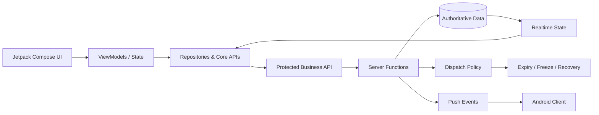

# Mingalarpar Taxi — Engineering Showcase

> Public engineering case study for a production-oriented native Android taxi platform with realtime dispatch, order recovery, trip lifecycle, finance operations and multi-role staff workflows.

## Why this repository exists

This is a **public portfolio showcase**, not the production source repository.

The full application source remains private because it contains proprietary implementation details. This repository presents architecture, engineering decisions and production problem-solving without exposing operational secrets or customer data.

No production credentials, raw database data, signing material, private infrastructure details or deployment logs are published here.

## Project at a glance

| Area | Engineering scope |
|---|---|
| Client | Native Android, Kotlin, Jetpack Compose, Material 3 |
| State | ViewModels, coroutines, Flow/StateFlow |
| Backend | Appwrite Database, Functions, Realtime and Storage |
| Notifications | Firebase Cloud Messaging |
| Location | Google Maps and Google Location Services |
| Roles | Customer, driver and multi-role staff workflows |
| Dispatch | Eligibility, offer control, expiry, freeze and recovery |
| Release posture | Externalized credentials, security checks and automated quality gates |

This showcase reflects the engineering direction of the private **1.5.x** source line.

## System architecture

The Android client expresses intent, while the backend validates session, role, dispatch eligibility and lifecycle state before authoritative mutations.

## Engineering highlights

### Server-authoritative lifecycle
Order acceptance, trip start/completion, finance changes and staff operations are checked by backend logic instead of trusting local UI state.

### Explicit dispatch controls
Dispatch is treated as a policy system with eligibility and offer state rather than a simple broadcast notification.

### Expiry, freeze and recovery
Order recovery is modeled as controlled state transitions. Expiry and freeze behavior are designed to avoid silently repairing state in ways that violate ownership or lifecycle rules.

### Session-generation fencing
Late network work from an older authentication session is prevented from becoming authoritative after a newer session is active.

### Idempotent transaction-sensitive flows
Settlement and finance behavior uses stable operation identity to reduce duplicate effects from retries.

### Realtime and push separation
Realtime synchronization and push delivery are complementary; notification delivery is not used as proof of business success.

## Product capabilities represented

- Customer booking and trip history
- Driver availability and dispatch
- Offer eligibility and acceptance
- Order expiry, freeze and recovery
- Realtime order/location synchronization
- Meter and fixed-fare trip flows
- Wallet, commission and finance operations
- Multi-role staff workflows
- Chat and operational notifications
- Reporting and analytics

## Failure modes considered

- stale sessions
- competing order claims
- dispatch races
- stale connected-order state
- partial lifecycle completion
- retry duplication
- realtime lag
- push delivery differences
- local/server state disagreement

## Repository guide

- [`docs/ARCHITECTURE.md`](docs/ARCHITECTURE.md) — dispatch and authority boundaries
- [`docs/ENGINEERING_CASE_STUDY.md`](docs/ENGINEERING_CASE_STUDY.md) — problem-solving approach
- [`SECURITY.md`](SECURITY.md) — public/private boundary
- [`LICENSE.md`](LICENSE.md) — portfolio-use terms

## Source access

The production source repository is private. Qualified employers or technical reviewers can request temporary read access for a deeper code review.

## Ownership

This showcase describes proprietary engineering work. Publishing this case study does not open-source the underlying application.
