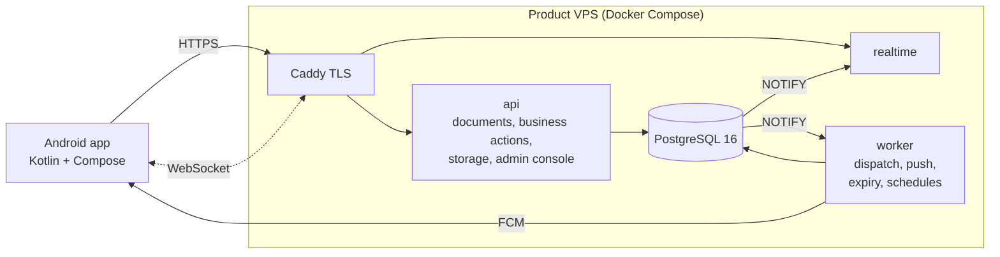

# Mingalarpar Taxi: Multi-Role Ride-Hailing App, Engineering Case Study

> A ride-hailing app in production for customers, drivers and staff, with vehicle classes, an SOS channel, a coin rewards economy and automatic order recovery.
> Its backend architecture is **callme-core**, the self-hosted platform designed for [Call Me Taxi](https://github.com/ywtzcloud/callme-taxi-showcase), extended with Mingalarpar's own product rules.

This repository is the **public case study** of the project: product scope, architecture, and the rules that make dispatch and money safe. The application and backend source are private. Qualified reviewers can ask for a guided code walkthrough.

---

## At a glance

| | |
|---|---|
| Users and data (Nov 2026) | 738 accounts, 703 driver profiles, 6,365 orders, 3,505 trips, 233,044 records in 39 collections, 879 media files |
| Android app | about 330 Kotlin files, Jetpack Compose, 2 languages, 3 role families (customer, driver, staff) |
| Server rules | 9 server-side services: business actions (~115), settlement, push, alerts, dispatch control, order expiry (scheduler, worker, watchdog), top-up guard |
| Platform | callme-core: Node.js, PostgreSQL 16, WebSocket realtime, durable job queue, one 4 vCPU / 8 GB VPS per product |

---

## Product features that set it apart

- **Vehicle classes.** Drivers declare their class once (EV or standard) and the lock is server-enforced. Customers pick a class with a transparent surcharge, and dispatch offers an order only to matching vehicles.
- **SOS channel.** Riders and drivers can raise an emergency. Staff get a dedicated red banner and an alarm-grade notification, with an acknowledgement ledger so no alert is silently lost.
- **Coin rewards.** Every coin movement goes to a ledger. Redemption has a threshold and staff approval, and redeem codes and admin tools sit on the same idempotent finance path as wallet operations.
- **Automatic order recovery.**
  - An order nobody accepts within **3 minutes** is frozen automatically.
  - A customer order waiting for staff review moves to citywide dispatch after **30 s**.
  - Both are race-safe: a driver accepting at the same moment always wins (see [docs/DISPATCH_AND_RECOVERY.md](docs/DISPATCH_AND_RECOVERY.md)).
- **Server-owned dispatch settings.** Staff tune ring timing (1–30 s) and the staff-review window from the app. Values are validated and stored on the server, not in the phone.
- **Scheduled orders.** Bookings for later get reminders 30 and 20 minutes before pickup, through chat and push, with delivery recovery if a reminder is missed.
- **Wallets.** Driver and customer wallets with top-up review, direct deposit and withdrawal, transfers and low-balance alerts. All are server-authoritative and replay-safe.

---

## Architecture

- Mingalarpar runs the **same platform code** as Call Me with its own database, Firebase project, settings and server rules. Each product gets its own VPS and domain, so an incident in one product cannot touch the other.
- Product-specific rules (vehicle classes, coins, SOS, expiry) plug into the same transaction, session and policy framework.

Details: [docs/ARCHITECTURE.md](docs/ARCHITECTURE.md).

---

## Engineering highlights

- **Race-safe automation.** The 3-minute auto-freeze stages its write inside a transaction that also read the order. If a driver accepts in between, the commit fails with a conflict and the freeze is abandoned, never overwritten. A once-a-minute watchdog re-checks only bounded pages of candidates, so a lost timer cannot strand an order.
- **Evidence-based audit of every server service.** Every deployed server function was exported, hashed and compared with the repository. The audit found a production service that had been **silently failing**: the top-up identity guard addressed a stale project id, so every call was rejected with 401 ([docs/ENGINEERING_CASE_STUDY.md](docs/ENGINEERING_CASE_STUDY.md)).
- **A measured comparison with the sister app.** Source trees were diffed with package names normalised: 57 identical files, 203 diverged (about 25,000 changed lines), 71 Mingalarpar-only files. The diff produced a porting plan: shared fixes are re-applied deliberately, product modules stay separate.
- **Security baseline** on the product server:
  - firewall with only 22/80/443 open;
  - fail2ban, which banned its first brute-force IP within seconds;
  - secrets entered only through hidden prompts and stored root-only;
  - read-only, least-privilege export keys.

---

## Repository guide

| Document | What it covers |
|---|---|
| [ARCHITECTURE.md](docs/ARCHITECTURE.md) | Platform, product modules, data, deployment |
| [DISPATCH_AND_RECOVERY.md](docs/DISPATCH_AND_RECOVERY.md) | Staff review, rings, vehicle classes, 3-minute auto-freeze, watchdog |
| [ENGINEERING_CASE_STUDY.md](docs/ENGINEERING_CASE_STUDY.md) | Audit findings and design decisions |
| [MIGRATION.md](docs/MIGRATION.md) | Moving a live product onto its own backend safely |
| [SECURITY.md](SECURITY.md) | What this public repository deliberately does not contain |

Platform design, security model and production incidents are documented in the [Call Me Taxi case study](https://github.com/ywtzcloud/callme-taxi-showcase).

---

© 2026. Portfolio material, see [LICENSE.md](LICENSE.md). The production application and backend are proprietary.
