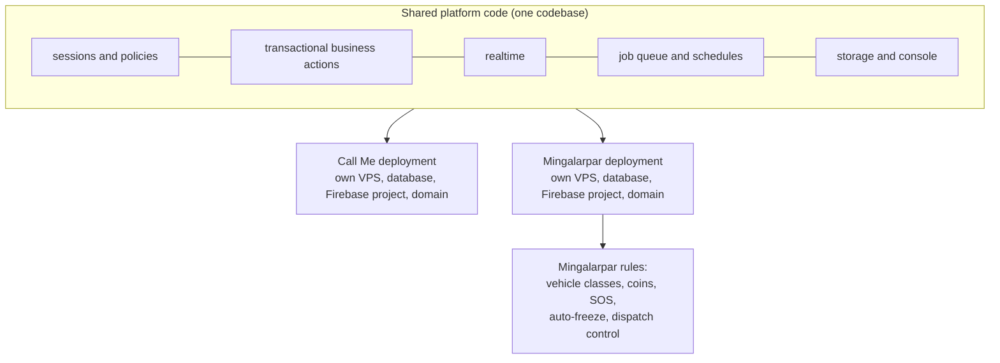

# Architecture

Mingalarpar Taxi is the second product on **callme-core**. The platform itself (API, realtime, job queue, data model, admin console, operations) is documented in the [Call Me Taxi case study](https://github.com/ywtzdev/callme-taxi-showcase/blob/main/docs/ARCHITECTURE.md). This page covers what is specific to Mingalarpar.

## One platform, isolated products

- **Isolation.** Each product has its own server, database, push project, secrets and backups. A bad deploy, a noisy customer or a leaked key affects only one product.
- **Shared fixes.** A platform improvement lands once and ships to both products. Examples: bulk offer fan-out, server-clock handling, realtime reconnect after login and per-event observability.
- **Product rules** are separate modules that use the same transaction, session and authorization helpers, so they inherit retries, idempotency and policy checks.

## Server-side services

| Service | Trigger | Responsibility |
|---|---|---|
| Business actions | request | ~115 actions: orders, accept/start/finish, wallet, coins, vehicle class, customer trips, staff tools |
| Settlement | request | trip finish and commission, verified against server prices |
| Push | data events | new-order waves, lifecycle notices, chat, wallet, announcements |
| Order alerts | event + every minute | scheduled-order reminders (30 and 20 min) and re-alerts |
| Dispatch control | request | staff-owned dispatch settings, staff decline/release |
| Expiry scheduler / worker / watchdog | event, delayed job, every minute | 3-minute auto-freeze, 30 s staff-window release, recovery sweep |
| Top-up guard | data event | removes pending deposits without a driver identity |

On callme-core the event and schedule triggers are rows in the platform's durable job queue: a delayed job replaces "schedule an execution at time T", and the every-minute services are worker timers. Each trigger is checked against production data before it is ported, so only services that are actually needed are kept.

## Data

- 39 collections, each mapped to a typed PostgreSQL table.
- Product-specific collections:
  - `CoinLedger`, `CoinRedemption`, `RedeemCode`;
  - `VehicleClassLockV1`;
  - `DispatchRuntimeConfig`;
  - `DirectTransferV2`, `CashWithdrawalV2`, `FinanceOperationV2`;
  - customer wallet ledgers.
- Dispatch offers are the largest table (about 206,000 rows). Old resolved offers are pruned by hourly maintenance.

## Android client

- Kotlin, Jetpack Compose and Material 3, with a product theme and UI kit.
- In-app language switching.
- ViewModels with `StateFlow` and per-domain repositories.
- Session epochs fence late responses after logout or re-login.
- Dedicated policies for recording interruption, lifecycle sounds, SOS alerts and low-wallet warnings, each with a unit-testable policy object separate from the UI.
