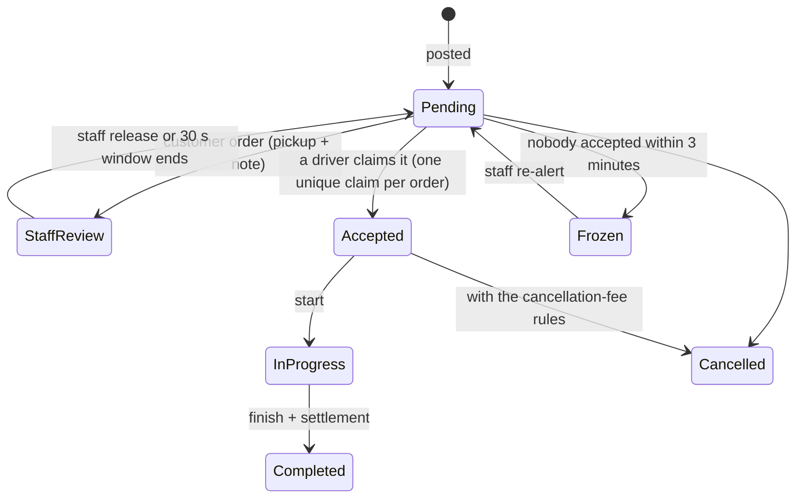

# Dispatch and recovery

## Lifecycle of an order



## Who is offered an order

- **Eligibility is decided on the server**: role, ban state, wallet floor, vehicle class matching the customer's choice, not the poster, not excluded, and not already busy where the rule requires it.
- **Waves and rings** follow the platform rules:
  - citywide orders go out in two waves;
  - distance orders expand through 1–4 km rings;
  - customer orders go to the nearest driver first.
- Ring timing is a staff setting, validated on the server (1–30 s).
- **Offers are records, not notifications.** A push only announces an offer. Accepting requires a matching open offer row, checked in the same transaction as the claim.

## Staff review window (customer orders)

- A customer order that needs staff attention is visible only to staff.
- Any staff member can decline their review offer. One decline releases the order to citywide dispatch immediately.
- If nobody acts, the order is released after **30 s**.
- The release is a guarded transition:
  1. read the order and its claim in one transaction;
  2. stage the move to `GLOBAL_READY`;
  3. commit.

  If a driver claimed it in the meantime, the commit conflicts and nothing is reopened.

## 3-minute auto-freeze

**Problem.** An order nobody takes clutters every driver's list and misleads the poster.

**Rule.** An unaccepted, non-manual app order is frozen 180 s after it becomes active:
- for a normal order, 180 s after it was created;
- for a scheduled order, 180 s after its scheduled time.

The rule has an operator kill switch and a cut-over date, so historical orders are never touched.

```mermaid
sequenceDiagram
  participant E as order created (event)
  participant S as scheduler
  participant W as worker (delayed job)
  participant D as database
  participant G as watchdog (every minute)
  E->>S: new order
  S->>W: run at created + 180 s
  W->>D: BEGIN; read order; still eligible?
  alt accepted meanwhile
    W->>D: ROLLBACK (no change)
  else still pending
    W->>D: stage status = frozen; COMMIT
    D-->>W: conflict if a driver claimed concurrently → abandon
  end
  G->>D: bounded sweep: due but not frozen? (5 pages × 100)
```

**Why three parts:**
- The **scheduler** runs once per order.
- The **worker** does the atomic freeze.
- The **watchdog** is the safety net when a delayed execution is lost.

On the old platform, delayed executions could be dropped, so the watchdog was essential. On callme-core, delayed work is a row in a durable queue in the same database, so it survives restarts. The watchdog becomes a cheap consistency check instead of a primary path.

## Scheduled orders

- **Reminders.** The creator and the assigned driver are reminded 30 and 20 minutes before pickup, by chat and by push.
- **Recovery.** Each reminder is claimed with a fingerprint, so it is sent once even if two runs overlap. A missed minute is caught by the next run's window query.
